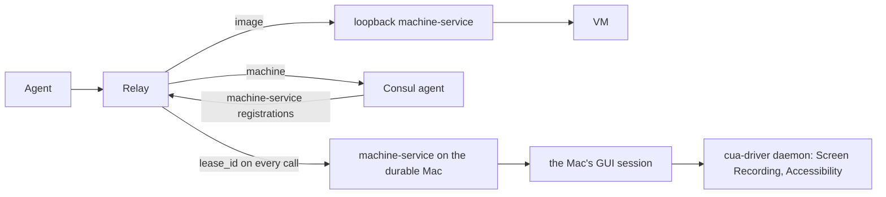

# Durable machines

This document is the design for DC-28 to DC-38 in [decisions.md](decisions.md#durable-machines). It is the relay's half of machine-service's [CN-1](../../vm-service/docs/arch/consumers.md#cn-1-mcp-relay).

## 1. Context

- A durable machine is a real Mac that machine-service exposes for exclusive leases. A lease on it is a session with a scratch workspace, not a fresh VM ([DM](../../vm-service/docs/arch/durable-machine.md)).
- The relay tools work on a durable machine as on a VM (DC-28). An agent names the machine instead of an image, and every other call, its order and its evidence stay the same.
- The relay reaches a VM through the loopback machine-service on its own host. A durable machine is usually owned by an instance on another Mac.

## 2. Choosing a machine (DC-29, DC-35, DC-37)

- `relay_acquire` takes exactly one of `image` and `machine`. `machine` is the durable machine's name as `machctl list` shows it, such as `Mac-A`.
- The relay finds the instance that owns the machine, as machctl does ([FD-2](../../vm-service/docs/arch/federation.md#fd-2-discovery)):
  1. It asks the loopback instance at `MCP_RELAY_URL` (default `http://localhost:6240`) for `/health` and `GET /machines`.
  2. It finds the other instances in the mode `MACHINE_SERVICE_DISCOVERY` chooses, as machine-service and machctl do (machine-service DC-84):
     - `bonjour`, the default: a one-shot Multicast DNS query for `_machine-service._tcp.local` (RFC 6762 §5.1), sent to 224.0.0.251:5353 from an ephemeral port, whose answers are read for 2 seconds, with one follow-up query for any SRV, TXT or A record the first answers left out. Each instance's TXT record states its `instance` and, when supported, its `machine_id`, still at `txtvers=1`. Node.js has no DNS-SD API, so the relay builds and reads the messages itself, with no dependency.
     - `consul`: the Consul agent at `CONSUL_HTTP_ADDR` (default `http://127.0.0.1:8500`), `GET /v1/health/service/machine-service`. A registration published as `loopback_only` on another Mac is skipped.
  3. It asks each instance found that way for its `/health`. When the advertisement or registration states `machine_id`, that ID must match; the instance's name may have changed. Older registrations are confirmed by their `instance` name as before, and a registration that states neither has no advertised identity to confirm. Then it asks for `GET /machines`.
  4. The owner is the instance whose list holds a record of `kind: "durable"` with that name. The same instance reached twice, such as the loopback instance and its own advertisement, counts once by `machine_id` and port, or by instance name when no machine ID is available. No owner, or two instances, refuses the acquisition before anything is reserved.
- The relay talks to a non-loopback origin only when discovery found it. The agent cannot name an address. Redirects and credentials in a URL stay refused.
- The guest's record keeps the owner's origin, instance name and `machine_id` when available. A restored guest follows that machine ID across a changed name or origin, as §8 describes. Without a saved machine ID, it still requires the original name, origin and instance name.
- A durable acquisition sends `machine`, `purpose`, `ttl_hours` and `env`. It sends none of `image`, `network`, `vnc` or `wait`, which machine-service refuses for a durable machine, so `vnc` is refused before anything is asked.

## 3. Lease operations (DC-30, DC-34)

- Every operation on a lease carries its `lease_id`: exec, push, pull, heartbeat and release. machine-service requires it on a durable machine and accepts it on a VM, so one rule serves both.
- The relay reads a durable record as a lease: its `name` is the machine's name, and `image` and `image_kind` are `null`.
- `durable machine leased` and `durable machine unavailable` are capacity refusals. relay_acquire waits for them as for the macOS VM limit (DC-22).

## 4. Files and staging (DC-31)

- On a durable machine every file goes as bytes. A push is `PUT /machines/<name>/files?lease_id=<id>&path=<remote>` with the file as `application/octet-stream` and its SHA-256 in `X-Content-SHA256`. A pull is the matching `GET`, whose digest the relay checks before it keeps a byte. Both are single files, as every relay transfer already is. A pull streams to disk as it is hashed, so a file of any size takes no memory of its size, and it is abandoned only when no byte arrives for 120 s, however long the whole file takes.
- The relay's root on a durable machine is `<workspace>/work/mcp-relay-<purpose>`, where `workspace` is what acquisition returns. machine-service removes the workspace at release, after the relay has extracted its evidence.
- VMs keep the path-based push and pull and `/var/tmp/<UTC time>-mcp-relay-<purpose>`.

## 5. Snapshots (DC-32)

- On a VM the image catalog decides whether runs take snapshots (DC-13, DC-19).
- On a durable machine the decision is made at the first relay_stage from two facts:
  1. the machine's capabilities list `software.cua_driver`;
  2. `cua-driver permissions status --json`, run in the lease, answers for the daemon.
- The cua-driver command-line tool is a thin client: `cua-driver call` hands the work to the `cua-driver serve` LaunchAgent, which holds Screen Recording and Accessibility as `com.trycua.driver`. The daemon's grants are therefore the ones that apply, and machine-service's own `permissions` are not read. machine-service is never granted Screen Recording (DC-28).

| Answer | Decision | Snapshots |
| --- | --- | --- |
| `source.attribution` is `driver-daemon` and `screen_recording` is `true` | granted | taken |
| `screen_recording` is `false` | denied | none |
| the command fails, or its answer is not the expected JSON | unknown | none |
| `source.attribution` is anything but `driver-daemon` | daemon not running | none |
| the capabilities list no `cua_driver` | absent | none |

- relay_stage reports the decision and its reason under `snapshots`. A machine without snapshots is still staged, as an image without capture software is.
- When snapshots are taken, DC-24's wait for a screenshot proves capture before relay_stage returns.
- The tool's path is the app bundle's, `/Applications/CuaDriver.app/Contents/MacOS/cua-driver`, because the login shell has no `cua-driver` on its `PATH` ([CN-3](../../vm-service/docs/arch/consumers.md#cn-3-what-a-durable-machine-needs-installed)). relay_stage's `cuaDriver` overrides it.

## 6. Release (DC-33)

- relay_finish and relay_release end the session with `POST /machines/<name>/release`, after the relay has extracted its evidence. machine-service stops the lease's processes, sweeps leftovers and removes the workspace.
- A durable release is verified when the record read through `GET /machines/<granted-name>?lease_id=<id>` no longer names the lease. A 404 requires the inventory check in §8. There is no Tart list to read.
- The release's hygiene record is kept in the guest's `<evidence>.lifecycle.json`.

## 7. What a durable machine is not

- A durable machine is a real Mac on the home network. It is not isolated from the home network, and the network setting of DC-17 does not apply to it.
- Its desktop may be shared with a CI job ([HY-5](../../vm-service/docs/arch/hygiene.md#hy-5-coexistence-with-the-ci-runner)).
- It has no console operations.
- The relay's instructions and relay_acquire's description say so.

## 8. A renamed Mac (DC-36, DC-37)

- A Mac's owner may rename it at any time. machine-service follows the rename live and keeps a held lease answering to the name it was granted under, and a Mac's permanent identity is its machine ID, the hardware UUID (machine-service DC-86 to DC-90, [MI](../../vm-service/docs/arch/identity.md)). The relay builds on that:
  - **At acquisition** it saves the owner's `machine_id` from `/health` or the durable record beside its origin, its instance name and the lease's granted name. Discovery also carries the ID from Bonjour TXT or Consul metadata and confirms it through `/health` when advertised.
  - **During the session** it keeps addressing every lease request by the granted name, at the saved origin. Record reads carry the lease ID as `GET /machines/<granted-name>?lease_id=<id>`, so machine-service can resolve that name after a rename. A rename does not interrupt an open connection.
  - **After its own restart** it finds the owner again by `machine_id` and confirms that ID through `/health`. A matching ID is accepted even when the instance name or origin changed, and the saved name and origin are updated. A different `machine_id` is refused before a lease operation is sent.
  - **When the saved origin stops answering** with a connection failure or timeout, it finds the owner again by `machine_id` once and retries the request once at the confirmed origin. If the owner cannot be confirmed or the retry cannot reach it, the relay retains ownership and reports the guest's state as unknown. This recovery never replays acquisition.
  - **Saved images** stay bound to the machine ID, relay session and enclosure, so a changed name or address does not invalidate evidence or block finish (DC-38).
- **A 404 is not a release (DC-36).** A durable machine outlives its leases, so "not found" from its owner proves nothing about the lease: the machine may have been renamed, or its owner may have restarted under a new name. The relay never checks a durable lease against the local Tart list, which never contains a durable machine. On a 404 during reconciliation or release verification, it finds the owner again by the saved `machine_id`, or by the granted name when no ID was saved, and reads the durable record from `/machines`. The lease is over only when that record names another lease or none (DC-33). When the owner cannot be found or its record cannot be read, the relay keeps the lease, saves the guest's state as unknown and reports an error.
- **Older services remain supported.** When no `machine_id` was saved, discovery still uses the machine name and a restored guest still requires the saved origin and instance name. Such a guest gains the durable 404 verification above, but cannot follow a changed name or origin by machine ID.
- A virtual machine is leased from the relay's own instance and addressed by its own name, so a rename of that Mac changes nothing for it.
