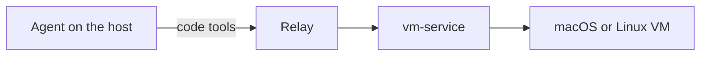

# Code runs in any guest

This document is the design for DC-12 to DC-15, DC-17 and DC-20 to DC-26 in [decisions.md](decisions.md#code-runs-in-any-guest).

## 1. Context

- An agent runs on a host. It works on the host with its own tools, and in a guest through the relay.
- A guest is a VM from vm-service, macOS or Linux.
- The agent runs scripts in the guest with `relay_script`: shell, JavaScript, TypeScript or Python. A command is a shell script. The scripts drive the software the image lists, such as cua-driver, Playwright and Chrome DevTools.
- The agent picks the image by the software it lists, with `relay_search`.
- An application that hosts agents, such as The Desk, starts the relay as a stdio MCP server for each of its agents, and passes the agent's working folder as `MCP_RELAY_PROJECT` and its task as `MCP_RELAY_SESSION`.

## 2. Backends (DC-12)

- vm-service stays the relay's only backend, behind `VmBackend` (`src/vm-service.ts`).
- A Docker-sandbox backend waits until a task needs it. On a Mac, Docker runs inside a Linux VM, so a container adds no isolation over a Linux VM, and no Docker image lists the software the agents use.

## 3. Software the relay assumes (DC-13)

- The relay assumes no software in a guest except Node.js, which runs the relay's own guest code.
- `relay_stage` pushes only the relay's own guest code, the receiver, with the workspace and the support files the agent asks for. It checks Node.js. It no longer requires cua-driver or a browser.
- The relay pushes no runtime. An image without Node.js cannot be staged, and `relay_stage` says so.
- **Snapshots.** A run takes its before and after snapshots only when the image lists capture software.
  - Capture software is cua-driver. The relay knows it by the catalog ids `bundle:com.trycua.driver` (macOS) and `dpkg:cua-driver` (Linux).
  - When the image lists no capture software, the run's record has no snapshots. The missing pair does not make the run `uncertain`.
  - When the image lists capture software, snapshots are taken and checked as today.
  - The host decides once per lease, at the first `relay_stage`, from the image's applications in the catalog, and tells the receiver with each run. A catalog that cannot be read refuses the stage, so a run never loses its snapshots by mistake.
  - When the image lists capture software, `relay_stage` waits until cua-driver takes a screenshot before it returns, asking every 2 s for up to 120 s (DC-24). The image starts cua-driver's daemon at login, which can follow the guest's readiness by tens of seconds.
  - A daemon that never answers refuses the stage with its error. The guest is kept, so the agent can start the daemon with a diagnostic shell script and stage again.

## 4. Where the relay is used (DC-14)

- The relay runs any work the agent chooses to run in a guest. It does not ask whether the work would interrupt a person.
- `relay_probe` reports host and service facts and the images. It no longer recommends keeping work local.

## 5. Host paths (DC-15)

- Every file the relay reads on the host lies in the project folder, `MCP_RELAY_PROJECT`. This holds for `relay_stage`'s `files[].local` and `workspace`, and for `relay_script`'s `localPath`.
- A relative path is resolved against the project folder. An absolute path must already lie in it.
- The check is `assertHostPath` with the project folder as its root, so a path that leaves the folder, or holds a symlink at or below it, is refused.
- The relay writes on the host only under the project folder, in `relay-evidence/`, and in its own state folder. This is unchanged.

## 6. The guest's network (DC-17)

- `relay_acquire` passes vm-service the `network` that `MCP_RELAY_GUEST_NETWORK` names: `nat`, the default, or `internet`.
- With `internet`, the guest reaches the internet, and reaches neither the host nor any private network (vm-service's DC-13).
- `relay_acquire` takes no network from the agent, so an agent cannot widen what its guest reaches.
- A vm-service that cannot give `internet` refuses the acquisition with its reason. The relay never falls back to `nat`.

## 7. Several guests in one session (DC-20)

- One relay session may hold several guests at once. An agent acquires one guest for each machine its work needs, and its subagents, which share its relay, may each work on their own guest at the same time.
- `relay_acquire` answers the guest's name, `guest`, which is unique in the session. Every tool that acts on a guest takes `guest`: `relay_stage`, the run tools, `relay_image`, `relay_extract`, `relay_finish`, `relay_release` and the console tools.
- `relay_status` and `relay_probe` list every guest the session holds, with its state.
- Each guest keeps its own lease and heartbeat, its own evidence folder under `relay-evidence/`, its own background downloads, and its own finish or release. Finishing or releasing one guest leaves the others running.
- Calls on different guests run at the same time. Calls on one guest keep their order, as today.
- A session holds at most `MCP_RELAY_MAX_GUESTS` guests, 4 by default. An acquisition beyond it is refused with a reason that names the guests held. The backend's own limits, such as two macOS VMs per host, still hold, and its refusals pass through.
- When the session ends, each guest's lease renewal pauses, as for one guest today.
- A guest's name is its task and a counter, such as `login-test-2`, and is never reused in the session. Its ownership record and owner lock live in `guests/<guest>/` in the session's state directory, so a restarted session restores every guest by name. The record of a relay from before DC-20 is restored as one guest named from its task.
- An acquisition that vm-service refuses acquires nothing: once vm-service lists no VM for it, its registry row goes and the guest leaves the session. An acquisition whose outcome is unknown keeps its guest for reconciliation, as before.

## 8. What the end of a session does (DC-21)

- A session ends when the client closes the relay's standard input, a write to its standard output fails, the relay is signalled (SIGTERM, SIGINT or SIGHUP), or the process that started it goes away, which the relay notices within two seconds even while its standard input stays open.
- `MCP_RELAY_ON_EXIT` says what the end does to the session's guests. Any value but `pause` or `release` stops the relay at startup.
- `pause`, the default, is the behaviour before DC-21: each guest's lease is renewed once for the rest of its TTL, renewal pauses, and the VM is kept for an explicit finish or release.
- `release` releases every guest the session holds, the guests a previous process of the same session left included, each through its own release path: the guest keeps the evidence the host can still pull, its VM is destroyed and verified gone, and its registry row and ownership record go. An operation the client already sent completes first, as with `pause`. Nothing waits for an agent: no result is delivered, and queued image downloads are folded into the release's own evidence pull.
- The release is bounded. The guests' releases share the shutdown grace period, `MCP_RELAY_SHUTDOWN_GRACE_MS`, 120 s by default; past it the operations in flight are cancelled, and a guest whose release has not ended within 5 s more is released directly, without pulling more evidence, in one attempt bounded at 60 s. Then the relay exits.
- A guest whose release fails keeps its ownership record and registry row, so a later session with the same `MCP_RELAY_SESSION` can release it. Its renewal stops without the final renewal `pause` makes, so its lease ends within its last renewal window, 15 minutes, plus the backend's grace period.
- An application that owns its tasks' machines, such as The Desk, sets `release`.

## 9. Waiting for capacity (DC-22)

- vm-service refuses an acquisition with HTTP 409 when the host is at capacity, such as when it already runs its two macOS VMs. It refuses before it reserves anything, so the same acquisition can be asked again. Its `wait: true` waits for a VM to boot, never for capacity.
- `relay_acquire` then waits instead of failing. It asks again every 15 s for up to `MCP_RELAY_CAPACITY_WAIT` seconds, 1800 by default; 0 turns waiting off. Any value but a nonnegative integer stops the relay at startup.
- Only the capacity refusal waits: a 409 whose error is vm-service's macOS VM limit and whose outcome is not uncertain. Every other refusal passes through at once, as before.
- A waiting guest keeps its name and its registry row, and counts against `MCP_RELAY_MAX_GUESTS`. `relay_status` shows it as `waitingForCapacity`, with since when, how many refusals and vm-service's reason, and the limit's refusal names it as waiting for capacity.
- A cancelled call or the end of the session stops the wait at once. Nothing was acquired, so the guest leaves the session as after any refusal, and a session that ends with `MCP_RELAY_ON_EXIT=release` still exits promptly.
- When the wait runs out, `relay_acquire` refuses with vm-service's reason and the time it waited. A granted acquisition's result says how long it waited, `waitedForCapacityMs`, 0 when it did not wait.

## 10. Every run is a script (DC-23, DC-25, DC-26)

- One tool runs anything in a guest, `relay_script`. It takes `guest`, `language` and `inline`, the script, and the optional `diagnostic`, `reason`, `step`, `snapshots` and `timeoutMs`.
- `language` is `shell`, `javascript`, `typescript` or `python`. A command is a shell script: `ls -al` is the shell script `ls -al`.
- `inline` says where the script is:
  - `inline: true` takes the script itself, `code`, up to 1 MiB.
  - `inline: false` takes `localPath`, a file in the project folder (DC-15).
  - A call gives exactly the one of `code` and `localPath` that `inline` names. Any other call is refused before it reaches the guest.
- The guest runs each language with its own runtime:
  - A shell script runs with `/bin/sh`, on macOS and on Linux. A script that needs another shell starts it itself, such as `exec /bin/zsh -c '…'`.
  - JavaScript runs with the Node.js that runs the receiver.
  - Python runs with `python3` from the guest's `PATH`.
  - TypeScript runs with `tsx` from the guest's `PATH`. When the guest has none, the receiver's Node.js runs the script with its own type stripping, which needs Node.js 22.6 or later (DC-25).
  - A run whose runtime is missing is refused before anything starts, so it never ends `uncertain`.
- `diagnostic: true` records a diagnosis or repair without snapshots, and may run before `relay_stage`.
  - Only a shell script may be diagnostic, because a diagnostic run goes through vm-service directly, not through the receiver, so it cannot rely on Node.js.
  - The guest runs the script as `/bin/sh -c <script>`. A script file is read on the host and sent the same way.
  - After `relay_stage`, the script runs in the recording workspace; before it, in the guest's default directory.
  - The result has one `output` field with stdout and stderr together. A diagnostic run cannot join a snapshot group, and it is never visual verification.
- A run has no kind. The tool call, the relay's run input, the request the guest receives and the run's events in the guest's journal name none:
  - The relay tells a script given inline from a script file by `inline`.
  - The guest tells them by the request: a request that holds `code` and its SHA-256 is a script given inline, and a request that names an uploaded `remotePath` and its SHA-256 is a script file.
  - The host SDK, relay-driver's, still names a kind and an interpreter when it frames a request. The relay's transport leaves both out of the request file it writes for the guest, so the guest's command comes only from the language and the verified script.
  - The guest builds the command that runs the script from `language` and the verified file. It never runs a command the request names, so no interpreter option can run other bytes than the verified script.
- A script drives whatever the image lists, such as cua-driver, Playwright or Chrome DevTools, through their own libraries or command lines.
  - The script decides whether it succeeded, by its exit status. A script that calls cua-driver reads the driver's answer itself and exits nonzero when the driver reports an error, even one it returned with exit status 0.
  - The receiver no longer reads the answer of a command that called `cua-driver call`, because no run is a bare command any more.
- The result of a run that is not diagnostic has the shape it had for both earlier tools: the outcome with its exit status, bounded `stdout` and `stderr`, `outputTruncated`, the step, the snapshots and the after-image's delivery.
- Removed: `relay_command`; and before it, `relay_exec` and `relay_code` under their old names, `relay_run`, `relay_gate` and `relay_tools`, `relay_run`'s MCP targets, the guest MCP host and the pinned servers the relay staged for them, `relay_stage`'s `browserExecutable`, which only those servers used, and `relay_image`'s `relay-run` application files. `relay_image` keeps the display snapshots and the declared application files.
- `relay_probe` with `scope: "guest"` reports, as facts, whether each language's runtime runs in the guest, `/bin/sh` included, and the software the image lists in the catalog. TypeScript is ready when `tsx` runs or the guest's Node.js strips types.
- The tools that manage a guest stay: `relay_search`, `relay_probe`, `relay_acquisition_capabilities`, `relay_acquire`, `relay_stage`, `relay_image`, `relay_extract`, `relay_finish`, `relay_release`, `relay_status` and the console tools.

## 11. Verification

- Unit tests cover DC-13, DC-15 and DC-17 with a fake backend, as `tests/console.test.ts` does.
- Unit tests cover DC-20 with the fake vm-service in `tests/manager.test.ts`: two guests run at the same time and finish on their own, each with its own evidence; calls on one guest keep their order; the guest limit; a call naming a guest the session does not hold; a restart that restores two guests; and a session state from before DC-20.
- Lifecycle tests cover DC-21 with the shipped server and a fake vm-service in `tests/lifecycle.test.ts`: with `release`, two guests are released when standard input closes, on SIGTERM and when the parent process goes away; with the default `pause`, both are kept and their renewal pauses.
- Unit tests cover DC-22 with the fake vm-service: a host at capacity twice and then free grants the acquisition with the time waited; a wait that runs out refuses with the reason and the time waited; a cancelled call and a session end stop the wait with nothing acquired, the shipped server included; a 409 that is not a capacity refusal, an uncertain one, and a wait of 0 are not asked again.
- Unit tests cover DC-24 with the fake vm-service: a cua-driver that fails three times and then answers is waited for, and the first run completes; one that never answers refuses the stage, keeps the guest, and a later stage succeeds; an image that lists no capture software asks for no screenshot.
- Unit tests cover DC-25: the receiver picks `tsx`, then Node.js type stripping, for TypeScript, and refuses a script whose runtime is missing; a TypeScript script runs without `tsx` and completes.
- Unit tests cover DC-23 and DC-26: `tools/list` serves `relay_script` and none of `relay_command`, `relay_exec`, `relay_code`, `relay_run`, `relay_gate` and `relay_tools`; `relay_script` runs inline code and a project file in each language, shell included, and refuses a call whose `code` or `localPath` does not match `inline`; a diagnostic shell script runs before and after `relay_stage` without snapshots, inline and from a file; a diagnostic script in any other language is refused; a guest without `/bin/sh` refuses a shell script before it starts; and no request the guest receives, and no event the guest journals for a run, names a kind of run.
