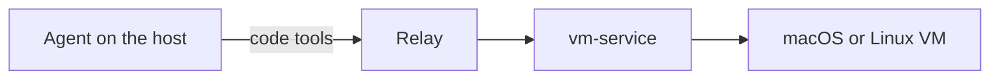

# Code runs in any guest

This document is the design for DC-12 to DC-15 and DC-17 in [decisions.md](decisions.md#code-runs-in-any-guest).

## 1. Context

- An agent runs on a host. It works on the host with its own tools, and in a guest through the relay.
- A guest is a VM from vm-service, macOS or Linux.
- The agent writes code that runs in the guest, with `relay_exec`, `relay_script` or `relay_code`. The code drives the software the image lists, such as cua-driver, Playwright and Chrome DevTools.
- The agent picks the image by the software it lists, with `relay_search`.
- An application that hosts agents, such as The Desk, starts the relay as a stdio MCP server for each of its agents, and passes the agent's working folder as `MCP_RELAY_PROJECT` and its task as `MCP_RELAY_SESSION`.

## 2. Backends (DC-12)

- vm-service stays the relay's only backend, behind `VmBackend` (`src/vm-service.ts`).
- A Docker-sandbox backend waits until a task needs it. On a Mac, Docker runs inside a Linux VM, so a container adds no isolation over a Linux VM, and no Docker image lists the software the agents use.

## 3. Software the relay assumes (DC-13)

- The relay assumes no software in a guest except Node.js, which runs the relay's own guest code.
- `relay_stage` pushes only the relay's own guest code, the receiver, with the workspace and the support files the agent asks for. It checks Node.js. It no longer requires cua-driver or a browser.
- The relay pushes no runtime. An image without Node.js cannot be staged, and `relay_stage` says so.
- **Snapshots.** A run takes its before and after snapshots only when the image lists capture software.
  - Capture software is cua-driver. The relay knows it by the catalog ids `bundle:com.trycua.driver` (macOS) and `dpkg:cua-driver` (Linux).
  - When the image lists no capture software, the run's record has no snapshots. The missing pair does not make the run `uncertain`.
  - When the image lists capture software, snapshots are taken and checked as today.
- `relay_run`'s targets keep their own requirements, and the relay still stages their pinned servers on first use. They are not changed by this design.

## 4. Where the relay is used (DC-14)

- The relay runs any work the agent chooses to run in a guest. It does not ask whether the work would interrupt a person.
- `relay_probe` reports host and service facts and the images. It no longer recommends keeping work local.

## 5. Host paths (DC-15)

- Every file the relay reads on the host lies in the project folder, `MCP_RELAY_PROJECT`. This holds for `relay_stage`'s `files[].local` and `workspace`, and for `relay_script`'s `localPath`.
- A relative path is resolved against the project folder. An absolute path must already lie in it.
- The check is `assertHostPath` with the project folder as its root, so a path that leaves the folder, or holds a symlink at or below it, is refused.
- The relay writes on the host only under the project folder, in `relay-evidence/`, and in its own state folder. This is unchanged.

## 6. The guest's network (DC-17)

- `relay_acquire` passes vm-service the `network` that `MCP_RELAY_GUEST_NETWORK` names: `nat`, the default, or `internet`.
- With `internet`, the guest reaches the internet, and reaches neither the host nor any private network (vm-service's DC-13).
- `relay_acquire` takes no network from the agent, so an agent cannot widen what its guest reaches.
- A vm-service that cannot give `internet` refuses the acquisition with its reason. The relay never falls back to `nat`.

## 7. Verification

- Unit tests cover DC-13, DC-15 and DC-17 with a fake backend, as `tests/console.test.ts` does.
